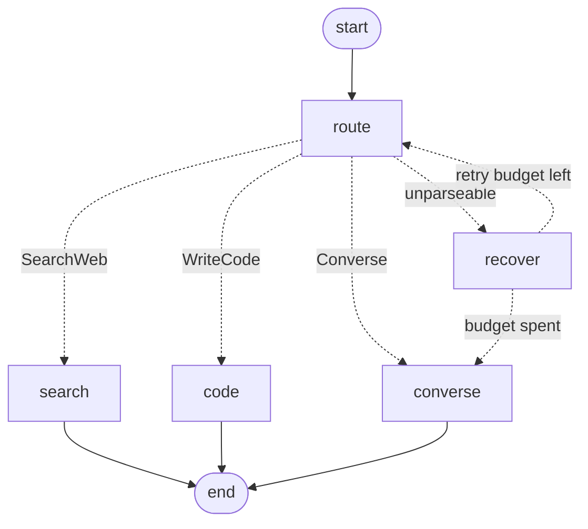

# Auralith

A multi-modal document assistant whose retrieval pipeline was **chosen by
measurement rather than by default**. Every configuration decision in this repo
is backed by a number in `results/`, and the negative results are recorded
alongside the positive ones.

Ask questions about a PDF and get answers with the source passages shown; ask
general questions and get routed by a LangGraph state machine to web search,
code generation, or conversation.

```bash
pip install -r requirements.txt
python eval/corpus/fetch_corpus.py     # fetch + checksum the eval corpus
cp .env.example .env                   # defaults are local-only, no API key
streamlit run main.py
```

Defaults run entirely locally: [Ollama](https://ollama.com) for generation,
`sentence-transformers/all-MiniLM-L6-v2` for embeddings, and a local
cross-encoder for reranking. Set `AURALITH_PROVIDER=openai` with an
`OPENAI_API_KEY` to swap in hosted models.

```bash
ollama pull llama3.2:3b     # generator
ollama pull qwen2.5:7b      # LLM-as-judge, evaluation only
```

---

## Architecture

```
                    ┌──────────────────────────────────────┐
   PDF ──────────▶  │  ingest: PyPDFLoader → per-page Docs  │
                    │  chunk:  RecursiveCharacterTextSplitter│
                    │          500 tokens / 100 overlap      │
                    └──────────────────┬───────────────────┘
                                       │ (doc_id, page) on every chunk
                                       ▼
                    ┌──────────────────────────────────────┐
                    │  Chroma, persisted to .chroma/<key>   │
                    │  one index per CHUNKING scheme        │
                    └──────────────────┬───────────────────┘
                                       ▼
    query ────────▶  dense retriever (k=6) ──▶ [optional: BM25 ensemble]
                                       │       [optional: multi-query]
                                       │       [optional: cross-encoder rerank]
                                       ▼
                    ┌──────────────────────────────────────┐
                    │  RAG chain → answer + cited passages  │
                    └──────────────────────────────────────┘
```

The optional stages are config flags, not code paths — which is what made the
sweeps in Phase B/C possible at all. See `auralith/retrievers.py`.

### Agent graph (Chat mode)



The `route → recover → route` cycle is why this is a graph and not a chain. A
linear LCEL pipeline cannot express "go back and try again", so a malformed
classification had nowhere to go but an exception.

### Layout

| path | contents |
|---|---|
| `auralith/` | retrieval, RAG, agent graph, tools — **no Streamlit imports** |
| `ui/` | Streamlit views — no model or retrieval logic |
| `eval/` | corpus fetcher, question set, metrics, judge, harness, sweeps |
| `results/` | every committed measurement, JSON + markdown |
| `tests/` | pytest suite |
| `docs/METHODOLOGY.md` | how the numbers are made and what they don't mean |

Nothing in `auralith/` imports Streamlit, which is what lets `eval/` exercise
exactly the code the app runs, headlessly.

---

## Results

Full methodology, including limitations, in
[`docs/METHODOLOGY.md`](docs/METHODOLOGY.md).

Evaluated on 28 questions over 3 arXiv papers (50 pages), pinned by SHA-256.
26 answerable, 2 deliberately unanswerable.

### Phase B — chunking (`results/sweep_chunking.md`)

k held at 4, dense-only, everything else fixed.

| config | chunks | size/overlap | recall@4 | hit@4 | MRR | prec@4 |
|---|---|---|---|---|---|---|
| baseline (inherited) | 50 | character 7500/100 | 0.6154 | 0.6538 | 0.5096 | 0.1731 |
| | 126 | recursive 500/50 | 0.6346 | 0.6923 | 0.5192 | 0.2404 |
| **winner** | **132** | **recursive 500/100** | **0.8077** | **0.8462** | **0.6763** | **0.2692** |
| | 79 | recursive 1000/100 | 0.5000 | 0.5385 | 0.4071 | 0.1635 |
| | 79 | recursive 1000/200 | 0.6731 | 0.6923 | 0.5801 | 0.2019 |
| | 50 | recursive 1500/150 | 0.6154 | 0.6538 | 0.5096 | 0.1731 |
| | 50 | recursive 1500/300 | 0.6154 | 0.6538 | 0.5096 | 0.1731 |

**recall@4 0.6154 → 0.8077 (+31% relative), MRR 0.5096 → 0.6763 (+33%).**

Three things worth pulling out:

1. **The inherited 7500-token chunk size never split anything.** 50 pages in,
   50 chunks out, mean 927 tokens, max 1384 — never within a factor of five of
   the configured 7500. "Chunking" in the original was just "one chunk per
   page". The 1500-token rows are byte-identical to the baseline on every
   question type for the same reason.

2. **Overlap is the dominant lever, not size.** At 500 tokens, 10%→20% overlap
   moves recall 0.6346→0.8077. At 1000 tokens, 0.5000→0.6731. Doubling overlap
   helped roughly twice as much as halving chunk size did.

3. **`1000/100` is worse than doing nothing.** At ~1000 tokens against a
   ~927-token mean page you introduce a split boundary but only 100 tokens of
   redundancy to survive it, and facts landing on the seam are lost. The damage
   is concentrated in factoid questions (recall 0.406 vs 0.562 baseline). The
   danger zone is a chunk size near the natural page length with thin overlap.

### Phase B — k (`results/sweep_k.md`)

On recursive 500/100.

| k | recall@k | hit@k | MRR | prec@k |
|---|---|---|---|---|
| 1 | 0.4615 | 0.5385 | 0.5385 | 0.5385 |
| 2 | 0.7308 | 0.7692 | 0.6538 | 0.4808 |
| 4 | 0.8077 | 0.8462 | 0.6763 | 0.2692 |
| **6** | **0.8846** | **0.9231** | **0.6917** | 0.2308 |
| 8 | 0.9038 | 0.9231 | 0.6917 | 0.1971 |
| 10 | 0.9038 | 0.9231 | 0.6917 | 0.1923 |

**k=6 chosen.** `recall@k` rises with k by construction so it is not a
like-for-like column; `hit@k` and `MRR` both hit their ceiling at k=6. The extra
0.019 recall at k=8 comes from one multi-page question and costs 33% more
context while dropping precision 0.231→0.197.

### Phase B — persistence

Not a quality change, and reported as what it is: a latency change. Same vectors
in, same neighbours out, so recall does not move.

| | cost |
|---|---|
| Build the 500/100 index (132 chunks) | **27.4 s** |
| Reuse it (all 6 configs in the k sweep) | **0.00 s** each |

Indexes are keyed on the **chunking scheme**, not the full config, because k,
hybrid weighting, reranking and query expansion are all query-time concerns.
That is what let a 23-configuration sweep pay for six embedding passes instead
of 23. The inherited code rebuilt the index inside the request handler on
*every question asked*.

### Phase C — hybrid search (`results/sweep_hybrid.md`)

On recursive 500/100, k=6. Weight is the dense share; BM25 gets the remainder.

| config | recall@6 | hit@6 | MRR | prec@6 |
|---|---|---|---|---|
| dense only | **0.8846** | **0.9231** | 0.6917 | 0.2308 |
| BM25 only (0.00) | 0.7308 | 0.7308 | 0.5846 | 0.1987 |
| hybrid 0.30 | 0.7308 | 0.7308 | 0.5974 | 0.1987 |
| hybrid 0.50 | 0.8654 | 0.8846 | 0.6904 | 0.2372 |
| hybrid 0.70 | **0.8846** | **0.9231** | **0.6962** | 0.2308 |
| hybrid 1.00 | 0.8846 | 0.9231 | 0.6917 | 0.2308 |

**Rejected. Off by default (`use_bm25=False`).**

My stated hypothesis was that BM25 would help `lexical` questions — the ones
turning on rare exact tokens like `FAISS`, `P100`, `WordPiece`. The by-type
data refuted it:

| | lexical | factoid | conceptual |
|---|---|---|---|
| dense only | **1.0000** | 0.8438 | 0.9000 |
| BM25 only | 0.7500 | 0.7500 | 0.6000 |
| hybrid 0.70 | 1.0000 | 0.8438 | 0.9000 |

Dense retrieval already scores **1.0000** on lexical questions — there was no
headroom for BM25 to add. On a 132-chunk, topically-narrow corpus, MiniLM has
plenty of signal for short distinctive queries. BM25 alone is *worse* on the
very slice it was supposed to own.

The best hybrid weighting moves aggregate MRR by **+0.0045**, which on 26
questions is well inside noise. Hybrid 0.50 does trade slices — factoid
0.8438→0.8750, conceptual 0.9000→0.7000 — but not in the predicted direction,
and the net is negative. Kept behind a flag, off.

### Phase C — cross-encoder reranking (`results/sweep_rerank.md`)

`cross-encoder/ms-marco-MiniLM-L-6-v2`, retrieve `fetch_k` then keep top 6.

| config | recall@6 | hit@6 | MRR | prec@6 |
|---|---|---|---|---|
| no rerank | **0.8846** | **0.9231** | 0.6917 | 0.2308 |
| rerank ← 10 | 0.8462 | 0.8462 | 0.6551 | 0.2564 |
| **rerank ← 20** | 0.8654 | 0.8846 | **0.7051** | **0.2692** |
| rerank ← 30 | 0.8654 | 0.8846 | **0.7051** | 0.2628 |

**A genuine trade-off, not a win.** MRR +0.0134 and precision +0.0384 (+16.6%
relative), against recall −0.0192 and hit −0.0385. The cross-encoder promotes
the best passage but drops one the bi-encoder had held.

`fetch_k=10` is worse on every metric — the pool is too small to rescue
anything. 20 and 30 are identical, so 30 buys nothing for 50% more compute.

By type (MRR) is where the mechanism shows:

| | factoid | lexical | conceptual |
|---|---|---|---|
| no rerank | 0.690 | 0.625 | 0.690 |
| rerank ← 20 | 0.615 | 0.750 | **1.000** |

Reranking takes **conceptual questions to perfect ranking** and mildly hurts
factoid. A cross-encoder scores (query, passage) jointly, so it is strongest
exactly where paraphrase matching matters and adds least where the answer is a
bare number the bi-encoder already located. Conceptual is 5 of 26 questions,
which is why a perfect slice only moves the aggregate a little.

### What is not measured

Stated here rather than left for someone to discover.

**End-to-end answer correctness has not been run to completion.** Every
configuration decision above was made on retrieval metrics, which are
model-free, deterministic, and take ~2 seconds per config. The generation-side
number would take ~110 s per question — over an hour per configuration on a 3B
model on CPU — and was not completed.

That is a real gap with a specific consequence: **the reranking trade-off is
unresolved.** MRR and precision improve while recall drops, and nothing in the
retrieval metrics can adjudicate that. It needs answer correctness. Reranking
is therefore implemented, measured, and left **off** rather than switched on
from a number that does not settle the question.

The harness supports it fully — `python eval/run_eval.py --config production`
produces `answer_correctness`, `abstention_accuracy` and `false_abstention_rate`,
with per-question checkpointing so an interrupted run resumes. The judge behind
it is validated at 9/10 against hand labels. It just has not been run to the
end.

**Query expansion (`MultiQueryRetriever`) has no number.** It is implemented and
config-gated in `auralith/retrievers.py` but was not swept. It is the one Phase C
feature without evidence either way, and it is off.

---

## Testing

```bash
pytest -m "not slow"    # fast: no model loads
pytest                  # includes real index + cross-encoder
```

| file | covers |
|---|---|
| `tests/test_metrics.py` | recall/MRR/precision, rank sensitivity, aggregation |
| `tests/test_chunking.py` | config validation, chunk metadata, index-key sharing |
| `tests/test_retrieval.py` | k contract, BM25, hybrid/rerank assembly |
| `tests/test_graph.py` | route parsing, node behaviour, recovery transitions |
| `tests/test_judge.py` | judge JSON extraction, abstention determinism |

The graph tests run against a scripted fake model, which is the point of the
rewrite: the interesting behaviour is what happens when the model returns
something *wrong*, and you cannot get a real model to do that on demand.

---

## What this is not

- **Not deployed and not production.** It runs locally. There is no hosting, no
  auth, no multi-user state, no rate limiting, no monitoring.
- **Not a general benchmark.** 28 questions on 3 NLP papers. One question is
  worth ~3.8 points of recall; differences under ~0.04 are noise. The chunking
  result (+0.19) clears that bar; the hybrid result (+0.0045) does not, which
  is why it was rejected.
- **Not tuned exhaustively.** The sweep is sequential and greedy, not a grid.
  Chunk size and k interact and were optimised in sequence, so this may be a
  local optimum.
- **Answer quality is bounded by a 3B local generator.** Retrieval metrics are
  model-independent and transfer; answer correctness would not.
- **Retrieval-only evidence.** Every decision rests on recall/hit/MRR/precision.
  End-to-end answer correctness was not run to completion — see
  [What is not measured](#what-is-not-measured).

## Provenance

This repo began as an inherited prototype that did not start —
`main.py` imported `from modules import Functions` while `Functions.py` sat at
the repository root with no `modules/` package anywhere. Commit 1 preserves that
original state verbatim so every later change has a real before/after diff.
The API key was a hardcoded empty string in two files, there were no tests, no
evaluation, no logging, no type hints, and `requirements.txt` pinned a version
of `langchain` that has never been published.
