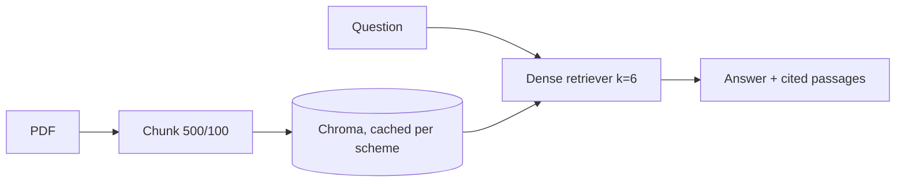
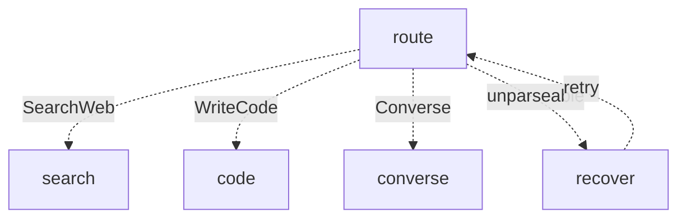

# Auralith

**A document Q&A assistant where every design decision is backed by a measurement.**

Ask questions about a PDF and get answers that cite their source passages. General
questions go through a LangGraph agent that picks between web search, code
generation, or conversation. It runs fully locally: no API key needed.

## Highlights

- **Retrieval recall up from 0.62 to 0.88.** Retrieval misses fell 78% (9/26 → 2/26) after systematic sweeps of chunking, k, hybrid search and reranking.
- **Wrongly refused answers down from 5/26 to 2/26** after a prompt change that lets the model give partial answers.
- **The LLM-as-judge is checked against hand labels.** The first judge agreed with a human only 15/24 times; the rewritten one agrees 21/24 (87.5%). Re-scoring older runs with it showed that the earlier answer-quality gain was an artefact of the first judge.
- **Negative results are reported too.** Hybrid BM25 search was hypothesised, tested and rejected (+0.0045 MRR, which is noise).
- **Every number has a 95% confidence interval** from a paired bootstrap, and any claim whose interval includes zero is labelled as not established.

## Results

28 questions over 3 arXiv papers, with the papers pinned by SHA-256.

| metric | baseline | tuned | 95% CI of delta |
|---|---|---|---|
| recall@k | 0.615 | **0.885** | [+0.12, +0.44] |
| hit@k | 0.654 | **0.923** | |
| MRR | 0.510 | **0.692** | [+0.03, +0.33] |

What made the difference:

| decision | finding |
|---|---|
| Chunking 500 / 100 overlap | The original 7500-token "chunking" never split a single page. **Overlap mattered more than size.** |
| k = 6 | hit@k and MRR stop improving at 6, and k=8 adds 33% more context for one question. |
| Hybrid BM25: **rejected** | Dense retrieval already scored 1.00 on the keyword-heavy questions BM25 was meant to help. |
| Reranking: **off** | A real trade-off: perfect ranking on conceptual questions, but lower recall. It needs an end-to-end run before it can be switched on. |

Retrieval is no longer the bottleneck. The right page now reaches the model for 24 of
26 answerable questions, so the remaining errors come from the 3B local generator.

Answer correctness, all runs scored by the same fixed judge and also checked by hand:

| run | judge | hand |
|---|---|---|
| baseline | 14/28 | 13/28 |
| tuned retrieval | 14/28 | 15/28 |
| tuned + partial-answer prompt | 16/28 | 19/28 |
| same, 7B generator (qwen2.5:7b) | **22/28** | **22/28** |

Better retrieval did not measurably improve answers: tuned fixes 8 baseline errors but
makes 6 new ones, all with the right page in context. The partial-answer prompt and the
7B generator each help, mostly on multi-part answers, but every correctness interval
still reaches zero on 28 questions, so no answer-quality gain is claimed. Details are in
[`results/comparison_ci.md`](results/comparison_ci.md).

Full tables, per-question-type breakdowns and limitations are in
[`docs/METHODOLOGY.md`](docs/METHODOLOGY.md) and [`results/`](results/).

## Architecture





- The optional retrieval stages (BM25, multi-query, reranking) are switched on by config flags, which is what made the sweeps possible.
- `auralith/` has no Streamlit imports, so the evaluation runs exactly the same code as the app.
- The `recover → route` loop is why the agent is a graph rather than a chain: a malformed classification gets retried instead of crashing.

## Quickstart

```bash
pip install -r requirements.txt
ollama pull llama3.2:3b
cp .env.example .env
streamlit run main.py
```

Set `AURALITH_PROVIDER=openai` and `OPENAI_API_KEY` to use hosted models instead.

To reproduce the evaluation:

```bash
python eval/corpus/fetch_corpus.py
ollama pull qwen2.5:7b                  # judge model
python eval/run_eval.py --config production   # or --config baseline
```

Tests: `pytest -m "not slow"`. The suite covers the metrics, chunking, retrieval, the agent graph's recovery paths (driven by a scripted fake model) and the judge.

## Limits

This is a local project, not a deployed product. The evaluation uses 28 questions on
3 NLP papers, so differences under about 0.04 recall are noise. Settings were tuned
one at a time rather than over a full grid, and answer quality is limited by a 3B CPU
model.

---

*Rebuilt from a 2024 prototype that didn't run: it had a broken import, a hardcoded API key, and a pinned `langchain` version that was never published. Commit 1 keeps it verbatim so you can see the before/after.*
